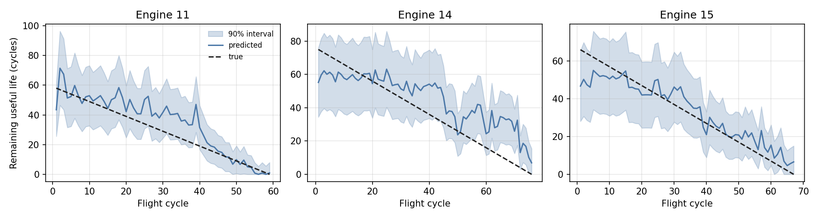
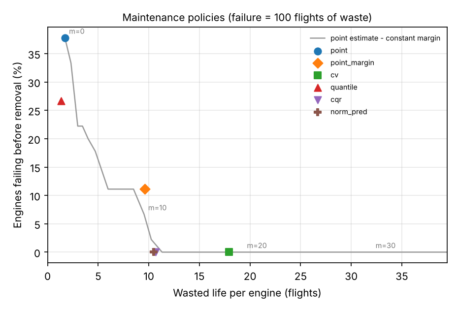

# Results

N-CMAPSS DS02: trained on engines 2, 5, 10, 16, 18 and 20 (446 flights), tested on engines
11, 14 and 15 (202 flights). Every number is a mean ± standard deviation over five seeds.
Each table is produced by the command named above it.

## Point prediction

`aerorul evaluate`

| Model | Test RMSE | Test MAE | NASA score per flight | CV RMSE |
| --- | ---: | ---: | ---: | ---: |
| **LightGBM** | **10.05 ± 0.43** | **7.88 ± 0.39** | **1.66 ± 0.16** | 10.96 ± 0.09 |
| Ridge | 12.75 | 9.93 | 2.48 | 17.06 |

Test RMSE per engine (LightGBM): engine 11: 9.00, engine 14: 12.87, engine 15: 6.71.

### Effect of history features

| LightGBM | Without history | With history (10 flights) |
| --- | ---: | ---: |
| Test RMSE | 10.59 ± 0.25 | **10.05 ± 0.43** |
| CV RMSE | 11.52 ± 0.05 | **10.96 ± 0.09** |
| CV NASA score per flight | 1.91 ± 0.02 | **1.59 ± 0.03** |
| 90 % interval width (cross-conformal) | 37.2 | **34.1** |

The same features hurt Ridge (CV RMSE 12.91 to 17.06): 146 correlated features on 446
flights overwhelm a lightly regularised linear model.

## Prediction intervals

`aerorul uncertainty`

| Target | Method | Coverage | Width (flights) |
| ---: | --- | ---: | ---: |
| 90 % | **Cross-conformal** | **90.4 % ± 1.5** | **34.1** |
| 90 % | Split conformal | 90.0 % ± 4.0 | 35.8 |
| 90 % | CQR | 98.5 % ± 0.9 | 50.5 |
| 90 % | Quantile regression | 82.2 % ± 0.9 | 36.8 |
| 80 % | **Cross-conformal** | **78.6 % ± 2.1** | **25.0** |
| 80 % | Split conformal | 75.0 % ± 4.2 | 25.8 |
| 80 % | CQR | 94.7 % ± 0.8 | 37.5 |
| 80 % | Quantile regression | 75.0 % ± 1.9 | 28.0 |

Coverage per test engine at the 90 % target:

| Method | Engine 11 | Engine 14 | Engine 15 |
| --- | ---: | ---: | ---: |
| Cross-conformal | 96.6 % | 80.3 % | 96.4 % |
| Split conformal | 92.5 % | 83.7 % | 94.9 % |
| CQR | 95.9 % | 99.5 % | 99.7 % |
| Quantile regression | 65.8 % | 88.9 % | 89.0 % |

!!! note "Reading the per-engine table"
    Conformal coverage is a guarantee on average over exchangeable points, not for each
    engine. Engine 14, which also has the largest point error, falls short of 90 %. Pooled
    coverage alone would hide it.

### Adaptive (normalised) intervals

`aerorul uncertainty` with `methods: [cv, norm_pred, norm_feat]`

| Target | Method | Coverage | Width (flights) |
| ---: | --- | ---: | ---: |
| 90 % | **Cross-conformal** | **90.4 % ± 1.5** | **34.1** |
| 90 % | Normalised, sigma(prediction) | 90.1 % ± 2.2 | 33.2 |
| 90 % | Normalised, sigma(features) | 99.8 % ± 0.3 | 56.9 |
| 80 % | **Cross-conformal** | **78.6 % ± 2.1** | **25.0** |
| 80 % | Normalised, sigma(prediction) | 79.1 % ± 2.6 | 24.9 |
| 80 % | Normalised, sigma(features) | 96.8 % ± 2.1 | 40.7 |

By phase of life, 90 % target, pooled over engines and seeds (width / coverage):

| Method | RUL <= 20 | 20 < RUL <= 50 | RUL > 50 |
| --- | ---: | ---: | ---: |
| Cross-conformal | 30.8 / 81.9 % | 35.6 / 94.9 % | 35.6 / 93.1 % |
| Normalised, sigma(prediction) | 21.9 / 74.0 % | 35.9 / 97.8 % | 42.8 / 96.7 % |
| Normalised, sigma(features) | 40.4 / 99.4 % | 62.3 / 100 % | 68.1 / 100 % |

Coverage per test engine at 90 %:

| Method | Engine 11 | Engine 14 | Engine 15 |
| --- | ---: | ---: | ---: |
| Cross-conformal | 96.6 % | 80.3 % | 96.4 % |
| Normalised, sigma(prediction) | 98.3 % | 77.9 % | 96.7 % |
| Normalised, sigma(features) | 99.3 % | 100 % | 100 % |

The cross-conformal interval is narrower below 20 flights only because its lower edge is
clipped at zero. The normalised interval moves width from the end of life to the start:
the marginal guarantee still holds, but coverage drops in the phase a planner cares about
most. Conformal guarantees are marginal; they say nothing about coverage within a phase
of life, so it has to be measured. The default remains cross-conformal.

## Maintenance decisions

`aerorul decide`

Book a removal `lead` flights ahead once the policy's statistic is at most `lead`.
Failure: less than `lead` flights left at booking. Waste: life left at removal.
Leave-one-engine-out over all nine DS02 engines, five seeds (45 decisions; seeds change
the model, not the engines, so this is nine engines' worth of evidence).

Lead time 10 flights, failure rate / wasted flights per engine / mean cost per engine:

| Policy | Failing | Waste | Cost, ratio 20 | 50 | 100 | 200 |
| --- | ---: | ---: | ---: | ---: | ---: | ---: |
| Point estimate | 37.8 % | 1.7 | 9.3 | 20.6 | 39.5 | 77.3 |
| Point - tuned margin | 11.1 to 26.7 % | 3.8 to 9.6 | 9.1 | 18.6 | 20.7 | 31.8 |
| Quantile regression | 26.7 % | 1.3 | **6.6** | 14.6 | 28.0 | 54.6 |
| Cross-conformal | 0 % | 17.9 | 17.9 | 17.9 | 17.9 | 17.9 |
| CQR | 0 % | 10.7 | 10.7 | 10.7 | 10.7 | 10.7 |
| Normalised conformal | 0 % | 10.5 | 10.5 | **10.5** | **10.5** | **10.5** |

The tuned margin depends on the ratio (mean 3.4, 7.8, 10.5, 10.5 flights); its failure rate
and waste change with it. Interval policies do not depend on the ratio.

Only when a failure costs as little as 20 flights of waste does accepting failures pay
(quantile regression). For any ratio a real operator would use, the calibrated lower
edges win.

Effect of the lead time (failure rate / waste; the tuned margin is left out because it
would have to be re-tuned for each lead time):

| Policy | Lead 5 | Lead 10 | Lead 15 | Lead 20 |
| --- | ---: | ---: | ---: | ---: |
| Point estimate | 51.1 % / 1.2 | 37.8 % / 1.7 | 48.9 % / 1.1 | 55.6 % / 1.7 |
| Quantile regression | 26.7 % / 1.6 | 26.7 % / 1.3 | 42.2 % / 5.0 | 20.0 % / 12.8 |
| Cross-conformal | 0 % / 16.4 | 0 % / 17.9 | 0 % / 16.5 | 0 % / 15.5 |
| CQR | 0 % / 7.3 | 0 % / 10.7 | 0 % / 28.0 | 0 % / 39.4 |
| Normalised conformal | 8.9 % / 9.1 | 0 % / 10.5 | 0 % / 13.3 | 0 % / 14.3 |

- Cross-conformal is the only policy with no failure at any lead time; its price is a
  steady 16 to 18 flights of waste.
- Normalised conformal is the cheapest safe policy from 10 flights of lead time upward.
  At 5 flights it fails engines: the decision then falls in the last flights of life,
  where its interval was shown to be too narrow.
- CQR is excellent at short lead times and wasteful at long ones: its lower quantile is
  conservative early in life.

## What the model looks at

`aerorul explain`

| Signal | Mean \|SHAP\| (flights of RUL) |
| --- | ---: |
| T50, LPT outlet temperature | 16.5 |
| Nc, core speed | 5.6 |
| T48, HPT outlet temperature | 3.3 |
| P15, bypass duct pressure | 2.0 |
| Nf, fan speed | 1.9 |

Fourteen of the fifteen most important features are ten-flight trailing means.

## Hyperparameter search benchmark

`aerorul benchmark`

| Optimiser | Best CV RMSE | Seeds won | Test RMSE of chosen config | Time per search |
| --- | ---: | ---: | ---: | ---: |
| TPE (Optuna) | **10.20 ± 0.09** | 4 / 5 | 11.04 ± 0.56 | 135 s |
| Random search | 10.31 ± 0.15 | 1 / 5 | 11.14 ± 0.94 | 56 s |
| ABC (abcopt) | 10.56 ± 0.17 | 0 / 5 | 11.12 ± 1.05 | 61 s |
| *Default parameters* | *10.96 ± 0.09* | | ***10.05 ± 0.43*** | |

Budget 60 evaluations, seven hyperparameters, leave-one-engine-out CV on the training
engines. TPE finds the lowest validation error, but every tuned configuration does worse
on the test engines than the defaults: with six training engines the search fits the
validation engines. The released configuration therefore keeps LightGBM's defaults.
